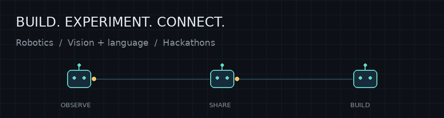

# Hi, I'm Siefeldin 👋

I’m a Statistics and Data Science PhD student at Utah State University. I enjoy hackathons, building things with a team, and turning ideas into working projects.

### What I'm exploring

🤖 **Robotics + VLMs + LLMs** — In Kevin Moon’s lab, I’m working on robot-to-robot communication: helping robots share and interpret observations without a central controller, and connect object annotations across their maps.

🛠️ **Hackathons** — I like the challenge of building something useful, trying ideas quickly, and learning along the way.

### A few things I've built

- **[VNForge](https://github.com/Siefeldin-Sobih/VNForge)** — Led a team for IBM’s Creative Builders Challenge to build a Python app that turns written scenes into editable dialogue, choices, and branching stories. It connects to Watsonx.ai, OpenAI, and Gemini, and exports playable Ren’Py projects.
- **[Random Bagles · Lucid bot](https://github.com/Siefeldin-Sobih/lucid_compeititon_randombagles)** — Built a rule-based strategy bot that balances mining, exploration, and expansion. Our final bot advanced to the **semifinals**.
- **Research tools** — Model interpretation for autoencoders, interactive Plotly/Dash views of gene-expression data, and reproducible analysis workflows.

### My toolkit

Python · R · PyTorch · NumPy · pandas · Plotly · Dash · Git · Nextflow · LLM APIs

My background is in computational biology; these days, I’m bringing that experience into statistics, AI, and robotics.

Always happy to connect about **hackathons, robotics, and projects with VLMs or LLMs**.

[Website](https://siefeldinsobih.com) · [Email](mailto:siefeldinsobih@gmail.com)

